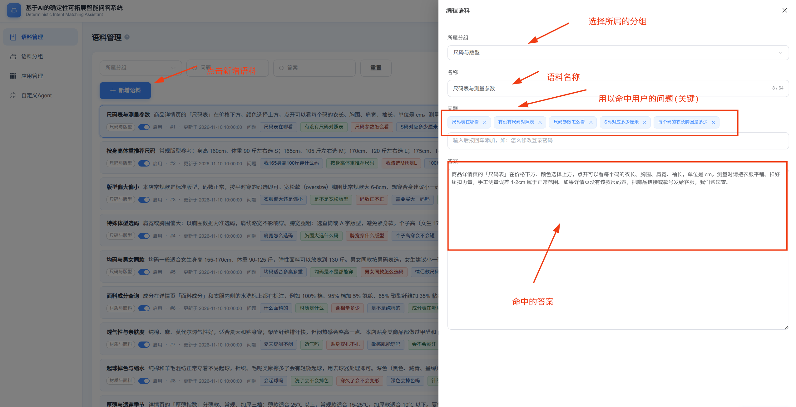
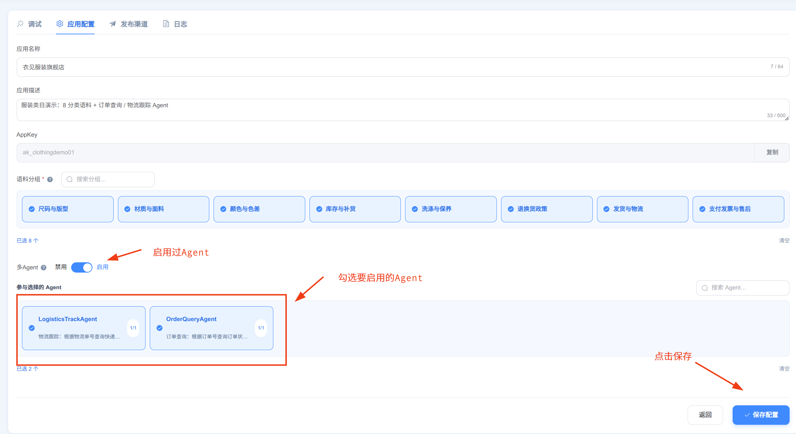

# 确定性 AI 客服 · Grounded RAG Customer Service

**答案只从你自己的语料里取，模型只负责组织语言——不会编、不会跑题、不会跨应用串答案。**

> A deterministic customer-service system. The LLM never writes an answer from its own knowledge: it may only rephrase a verified answer that was hit by keyword anchoring inside your own corpus. Spring Boot 3.5 + Vue 3 + MySQL 8, one `docker compose up` to run.




---

## 这套系统在解决什么问题

普通 RAG 客服是「向量检索片段 + 模型自由生成」：检索到的片段喂给模型，由模型组织成答案。好处是覆盖面广，坏处是数字、政策、承诺都可能是模型「顺嘴编的」。

本项目把最后一步换掉了：

```text
用户问题
  └─▶ 模型映射成「系统关键词」
        └─▶ 关键词必须命中当前应用语料（改写、编造、跨应用的词一律丢弃）
              └─▶ 取出该条语料里的标准答案
                    └─▶ （可选）模型只做措辞润色，不改变答案内容
```

带来的三个直接结果：

- **答案可追溯**：每条回复都能定位到语料里的某一条问答对，可直接审计。
- **改答案就是改语料**：不用重训、不用反复调 prompt，编辑后台里改一行就生效。
- **不命中就不答**：没有命中时按应用策略兜底或拒答，而不是让模型「猜一个」。

---

## 这适合你吗

| ✅ 适合 | ❌ 不适合 |
|---|---|
| 答案必须准确可控的客服场景（政策、价格、售后、合规） | 开放式闲聊、情感陪伴类机器人 |
| 已有现成 FAQ / 标准话术，希望「答得准」而不是「答得多」 | 需要模型自由归纳 300 页手册、泛化回答任意问题 |
| 想自部署、不按 token 计费、语料不出内网 | 只想用 SaaS 拖拽配置、零运维 |
| 多业务线需要按意图路由到不同处理逻辑 | 单轮无状态、无需任何记忆与上下文的场景 |

> 一句话判断：**如果「标准答案」本来就写好了，只是需要被准确取出来——这是本项目的场景；如果需要模型「读一堆资料然后自己组织新答案」——那应该用向量 RAG。**

---

## 和常见方案的区别

| 维度 | 本项目 | 典型 RAG 客服（Dify / FastGPT / RAGFlow / Coze） |
|---|---|---|
| 答案来源 | 语料库中的标准答案 | 检索片段 + 模型生成 |
| 会不会编造 | 结构上不会：答案必须命中语料 | 取决于模型与 prompt，可能幻觉 |
| 命中可解释性 | 强：命中的关键词、问答对都可查 | 弱：相似度分数，难以解释 |
| 改知识 | 编辑语料，立即生效 | 重建索引 / 重新向量化 |
| 多意图业务 | 多 Agent 路由（laya 决策模型 / LLM 排序） | 主要靠 prompt 与工作流编排 |
| 部署形态 | 2 后端 + 1 前端 + MySQL，单机 Compose | 通常一套平台 + 向量库 |

> 不是替代品，是取舍。两条路线解决的是两类不同的问题。

---

## 快速开始（Docker Compose）

````shell
cd deploy
docker-compose -f docker-compose-quickstart.yml up -d
````

- 管理后台：`http://<host>:8081/apps/`
- 聊天窗口（免密）：`http://<host>:8081/chat/chat/<windowKey>`
- 演示数据自带账号：管理后台 `admin / Admin@123`，聊天窗口账密入口 `cloth / Cloth@123`（首次登录后请改密）

### 前置依赖条件

- Docker 20.10+，并安装 `docker compose` 插件或 `docker-compose`
- 一个 OpenAI 兼容的大模型服务
- 从源码构建另需构建环境：JDK 21 + Maven 3.9+，Node.js 20+

### 公共步骤：数据库与环境变量（两条路径都要做）

**1) 配置环境变量**：

```bash
cd deploy
cp .env.example .env
vi .env
```

**必填变量**（与 `.env.example` 一一对应）：

| 变量 | 说明 | 示例 |
|---|---|---|
| `MYSQL_ROOT_PASSWORD` | MySQL root 密码，后端用同一账号连接 | `mysql_root` |
| `LLM_BASE_URL` | 模型服务地址，**必须容器可达** | `http://172.16.1.200:8788` |
| `LLM_MODEL` | 模型名 | `deepseek-v4.1-flash` |
| `LLM_API_KEY` | 模型 key，**必填**（代码里已无内置默认值） | `sk-...` |
| `FRONT_HOST_PORT` | 前端对外端口 | `8081` |
| `MYSQL_DATABASE` | 库名 | `server` |

**有默认值、按需调整**：

| 变量 | 默认值 | 说明 |
|---|---|---|
| `JAVA_OPTS` | `-Xms512m -Xmx1g` | portal / manage 各一个 JVM，分别生效 |
| `LOG_LEVEL` | `info` | 业务日志级别 |
| `LLM_LOG_ENABLED` | `false` | 打印模型请求/响应体，排查时临时打开 |
| `LAYA_ENABLED` | `false` | laya 决策模型开关，开启需把 `-Xmx` 调到 3g 以上 |

> 镜像名固定为 `portal:latest` / `manage:latest` / `front:latest`（与 `docker-compose.yml` 一致），要推送到自己的仓库请在构建后自行 `docker tag` / `docker push`；
> 快速开始编排里三个应用镜像已指向已发布地址，并配置了 `pull_policy: always`，每次 `up` 都会强制拉取最新镜像。其余逐项说明见 `deploy/CONFIG.md`。

> 容器内 `127.0.0.1` 指向容器自身；模型服务在宿主机时，需用宿主机内网 IP
> 或 `http://host.docker.internal:8788`。

### 构建再部署（从源码构建）

以下命令在**仓库根目录**逐行执行，产物镜像名固定为 `portal:latest`、`manage:latest`、`front:latest`，与 `docker-compose.yml` 的 `image` 一致。

**B1. 打包后端** —— 需要 JDK 21 + Maven：

```bash
mvn -f backend/pom.xml -pl portal,manage -am clean package -DskipTests
```

**B2. 构建后端镜像** —— 两条命令，产出 `portal:latest` 与 `manage:latest`：

```bash
docker build -f deploy/Dockerfile.portal -t portal:latest .
docker build -f deploy/Dockerfile.manage -t manage:latest .
```

> 仓库根目录的 `.dockerignore` 是白名单，只把 `backend/portal/target/portal.jar`、
> `backend/manage/target/manage.jar` 等构建产物送进上下文，不会把整个仓库（含 node_modules）传过去。
> 两个 Dockerfile 的基础镜像都固定为官方 `eclipse-temurin:21.0.12_8-jre-ubi10-minimal`，不接受配置；拉不到请自行处理网络或镜像源。

**B3. 构建前端镜像（front）** —— 需要 Node.js 20+

```bash
npm -C front install
npm -C front run build
npm --prefix chatfront install
npm --prefix chatfront run build
docker build -f deploy/Dockerfile.front -t front:latest .
```

> 静态资源的 base 已在各自 `vite.config.js` 里按 build 固定（`/apps/`、`/chat/`）。
> 基础镜像固定为官方 `nginx:1.30.6-trixie-perl`，不接受配置；拉不到请自行处理网络或镜像源。

**B4. 启动**：

```bash
cd deploy
docker compose up -d
docker compose ps
```

### 访问系统（两条路径通用）

| 入口 | 地址 |
|---|---|
| 管理后台 | `http://<host>:8081/apps/` |
| 聊天窗口（免密） | `http://<host>:8081/chat/chat/<windowKey>` |
| 聊天窗口（账密） | `http://<host>:8081/chat/login/<appKey>` |

- 管理后台账号来自初始化 SQL 的 `sys_user` 表；使用演示数据时自带账号 `admin / Admin@123`。
- 聊天窗口「账号密码」入口的账号来自 `app_password_window` 表，演示数据自带 `cloth / Cloth@123`。
- 首次登录后请修改密码，并替换初始化 SQL 中的默认凭证（演示密钥清单见 `deploy/CONFIG.md` 第七节第 7 条）。

### 停止与清理

```bash
cd deploy
docker compose down        # 停止并删除容器，保留数据
rm -rf mysql/data          # 删除 MySQL 数据目录，下次启动重新执行初始化 SQL
```

> 用 `docker-compose-quickstart.yml` 启动的，命令加 `-f docker-compose-quickstart.yml` 即可。

### 部署注意事项

- 没有 Flyway/Liquibase，表结构与基础数据完全依赖 `deploy/mysql/init/`。
- `front` 会等 `manage` / `portal` 健康后再启动；若仍出现 502，先看 `docker compose ps` 与 front 日志，确认两个后端是 `Up (healthy)`。
- `LAYA_ENABLED=true` 需要额外挂载模型目录，并把 `JAVA_OPTS` 的 `-Xmx` 调整到 `3g` 以上。
- 生产环境建议将 `LLM_LOG_ENABLED` 设为 `false`，排查时再临时打开。

---

## 核心特性

### 确定性问答

- 用户输入先由模型映射成「系统关键词」，关键词必须存在于当前应用的语料中，改写、编造、跨应用的词一律丢弃。
- 答案只来自语料库，模型只负责组织语言，不自由发挥。
- 应用提示词留空时，直接返回命中的标准答案，省掉一次模型调用。

### 语料体系

- 语料分组、问答对、同义问句、启用/停用。
- 按应用绑定语料分组，不同应用的语料互不可见。

### 多 Agent 路由



- 按应用维度开关，关闭时固定走默认 Agent，行为与单 Agent 完全一致。
- 开启后可选择两种选择策略：
  - **laya 决策模型**：进程内推理，毫秒级返回，结果确定；
  - **LLM 排序**：兼容性好，但每次选择多一次大模型调用。
- 未达阈值、候选为空或选中的 Agent 未绑定到该应用时，自动回落默认 Agent。

### 多渠道接入

- API 接入（AppKey）
- 免密窗口（windowKey 直达链接）
- 账号密码窗口
- 微信个人号

### 应用级配置

- 每个应用独立配置提示词、温度、topP、最大输出 token、对话记忆轮数与 Agent 范围。
- 对话记忆按「应用 + 会话」隔离，不串话。

### 调试与可观测

- 应用调试、Agent 调试（SSE 流式）、Agent 提示词覆盖。
- 对话日志、渠道日志、模型请求/响应日志开关。
- 所有日志级别由一个 `LOG_LEVEL` 变量统一控制。

---

## 系统架构

```text
浏览器 / 接入渠道
        │
        ▼
┌──────────────────────────────────────────────┐
│ front（Nginx，宿主机 :8081）                  │
│   /apps/*    管理后台静态资源                 │
│   /chat/*    聊天窗口静态资源                 │
│   /manage/*  ──▶ manage:8080                 │
│   /portal/*  ──▶ portal:9090                 │
└───────────────┬──────────────────┬───────────┘
                │                  │
                ▼                  ▼
┌───────────────────────┐  ┌───────────────────────┐
│ manage（:8080）        │  │ portal（:9090）        │
│ 经 gRPC :9091 调 portal│  │ 对外问答入口           │
└───────────┬───────────┘  └───────────┬───────────┘
            └──────────────┬───────────┘
                           ▼
                   MySQL（:3306，仅内网）
```

- `manage`：独立容器，:8080，管理后台接口、登录鉴权、语料/应用/渠道/日志管理，经 gRPC 调用 portal。
- `portal`：独立容器，:9090 对外问答、:9091 gRPC；负责 Agent 执行、多 Agent 选择、各渠道消息处理。
- 只有 `front` 映射宿主机端口，portal / manage / MySQL 均在 Compose 内网。

---

## 使用手册

详细使用与开发说明见 `docs/` 目录：

| 手册 | 内容 |
|---|---|
| [快速开始使用客服系统](docs/01-创建一个基于问答的AI客服.md) | 从登录后台、语料、应用、配置到 API 与免密窗口访问的完整操作流程 |
| [开启带多 Agent 的客服](docs/02-开启带多Agent的客服.md) | 为应用配置内置的订单/物流 demo Agent，查看多 Agent 效果 |
| [开发自定义的 Agent](docs/03-开发自定义的Agent.md) | Agent 注解、黑板绑定、抽象基类复用、调试变体，以及 Agent 的配置/选择/执行链路 |
| [开启基于决策模型 laya 来替换 LLM 选择 Agent](docs/04-开启基于决策模型laya来替换llm选择agent.md) | laya 开关、模型位置配置、网络受限时把模型打进 Docker 镜像 |

---

## 本地开发

本地开发不使用 Compose，后端两个服务与两套前端分别启动。后端需要本地/远程 MySQL 与模型服务，portal 与 manage 各开一个终端：

```bash
cd backend
mvn -pl portal -am spring-boot:run
```

```bash
cd backend
mvn -pl manage -am spring-boot:run
```

管理后台：

```bash
cd front
npm install
npm run dev
```

聊天窗口：

```bash
cd chatfront
npm install
npm run dev
```

- 管理后台开发端口固定为 `5180`，`/manage` 由 Vite 代理到 `http://localhost:8080`。
- 聊天窗口的 `/portal` 由 Vite 代理到 `http://localhost:9090`。
- 本地数据库连接通过 `MYSQL_HOST`、`MYSQL_PORT`、`MYSQL_USER`、`MYSQL_PWD`、`MYSQL_DATABASE` 覆盖。

> 从源码构建 Docker 镜像的完整命令见上文「构建再部署（从源码构建）」。

---

## 目录结构

```text
.
├── backend/                 # Maven 多模块 Spring Boot 工程
│   ├── common/              # 公共组件（SSE 等）
│   ├── dao/                 # 实体、Mapper
│   ├── rpc-api/             # gRPC 接口定义
│   ├── rpc-api-client-starter/
│   ├── portal/              # 问答入口、Agent 执行、渠道接入
│   └── manage/              # 管理后台接口
├── front/                   # 管理后台（Vue3 + Element Plus）
├── chatfront/               # 聊天窗口（Vue3 + Element Plus）
├── deploy/                  # Docker Compose 部署（对外发布）
│   ├── docker-compose.yml           # 本地构建镜像的编排
│   ├── docker-compose-quickstart.yml# 仓库发布镜像的编排（镜像地址已指向公开仓库）
│   ├── Dockerfile.portal            # portal 运行镜像（只含 portal.jar）
│   ├── Dockerfile.manage            # manage 运行镜像（只含 manage.jar）
│   ├── Dockerfile.front             # 前端 Nginx 镜像（上下文含 dist + nginx.conf）
│   ├── .env.example                 # 环境变量模板
│   ├── CONFIG.md                    # 配置核验清单
│   ├── mysql/init/                  # 首次启动执行的 SQL（含演示数据，随仓库提交）
│   └── nginx/front.conf             # 单入口静态托管 + 接口反代
└── docs/                    # 使用与开发手册
```

---

## 技术栈

| 层 | 技术 |
|---|---|
| 后端 | JDK 21、Spring Boot 3.5、Spring Security + JWT、MyBatis-Plus、gRPC |
| Agent | Embabel、LangChain4j、laya 决策模型 |
| 前端 | Vue 3、Vite、Element Plus、vue-router |
| 数据库 | MySQL 8 |
| 部署 | Docker Compose、Nginx 单入口 |

---

## 常见问题

**Q：启动后页面 502？**
`front` 已配置为等 `manage` / `portal` 健康后再启动。若仍 502，先执行 `docker compose ps` 确认两个后端是 `Up (healthy)`，再用 `docker compose logs -f front` 查看 nginx 报的是连接拒绝还是上游主机名解析失败。

**Q：改了初始化 SQL 不生效？**
`init/*.sql` 只在数据目录为空时执行。数据直接存在 `deploy/mysql/data`（相对路径绑定挂载），
先 `docker compose down`，再 `rm -rf deploy/mysql/data`，重新启动即可重新初始化。

**Q：问答报模型连接失败？**
检查 `LLM_BASE_URL` 是否为容器可达地址，以及模型服务是否兼容 OpenAI 接口。

**Q：多 Agent 一直不切换？**
依次检查：应用的「多 Agent」开关、`app_agent` 绑定、`LAYA_ENABLED`、选择阈值与日志中的命中分布。详见 [多 Agent 手册](docs/02-开启带多Agent的客服.md) 与 [laya 手册](docs/04-开启基于决策模型laya来替换llm选择agent.md)。

**Q：开启 laya 后容器被 OOM Kill？**
laya 模型常驻约 2.5G 堆，需将 `JAVA_OPTS` 的 `-Xmx` 调到 `3g` 以上，并预留启动时间。

---

## 许可证

本项目采用 [Apache License 2.0](LICENSE)。
