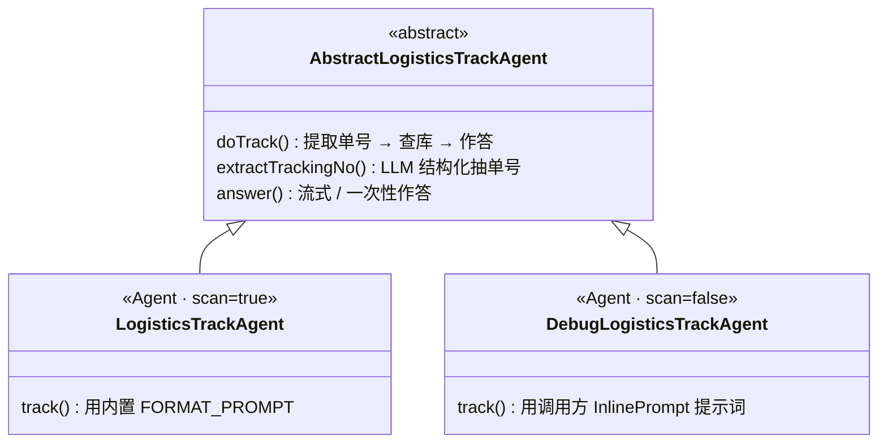
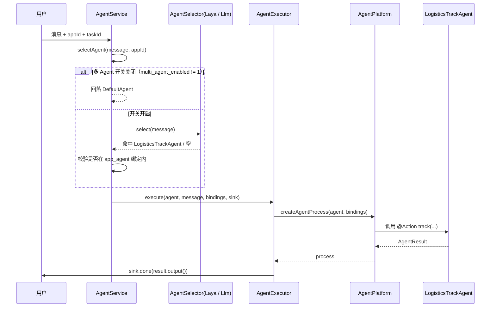

# 开发自定义的 Agent

本文以 `backend/portal` 里物流跟踪的 3 个 demo 文件为例，讲清楚两件事：

1. **如何开发一个 Agent**：从数据结构、抽象基类到 `@Agent` 类的完整写法；
2. **Agent 在什么地方被配置进去使用**：从扫描注册、应用绑定、意图选择到最终执行的完整链路。

这三个文件是：

| 文件 | 职责 |
| --- | --- |
| `AbstractLogisticsTrackAgent` | 抽象基类，提取 → 查询 → 作答的逻辑只有这一份，没有 `@Agent`/`@Action` |
| `LogisticsTrackAgent` | 正式 Agent，被平台扫描注册，参与多 Agent 选择 |
| `DebugLogisticsTrackAgent` | 调试变体，`scan=false` 不参与扫描，仅供调试入口执行 |

> 路径：`backend/portal/src/main/java/com/zidong/portal/agent/demo/` 下。
> 另一组 demo（`AbstractOrderQueryAgent` / `OrderQueryAgent` / `DebugOrderQueryAgent`）结构完全相同，
> 只是把「物流单号 + `demo_logistics` 表」换成「订单号 + `demo_order` 表」，本文不再重复拆解。

---

## 1. 前置概念

### 1.1 Agent 是什么

项目里的 Agent 是 **embabel agent 框架**的一个「被扫描注册的 Spring bean」：它对外暴露若干可被调用的动作方法（`@Action`），
框架的 planner 根据黑板里的数据决定调用哪个动作，最终由标注 `@AchievesGoal` 的动作产出结果。

本项目的 Agent 都刻意写成**单步 Agent**——一个方法同时是 `@Action` 又是 `@AchievesGoal`，
没有多步规划，planner 找到唯一可执行的计划后直接调用它。

### 1.2 四个核心注解

| 注解 | 作用 | 本项目用法 |
| --- | --- | --- |
| `@Agent` | 把类标记为 Agent，描述它「能干什么」 | `description` 给意图选择器看；`scan` 决定是否被框架自动扫描 |
| `@Action` | 标记一个可被 planner 调用的动作方法 | 用 `description` 说明该动作做什么 |
| `@AchievesGoal` | 标记「完成目标」的动作，其返回值是最终结果 | 单步 Agent 里和 `@Action` 标在同一个方法上 |
| `@Provided` | 标记方法参数来自**黑板绑定**（由调用方绑定），而非 planner 从前置动作输出推导 | 所有黑板参数都用它 |

`@Agent` 的关键属性：

```java
@Agent(description = "物流跟踪：根据物流单号查询快递配送进度与预计送达时间")
public class LogisticsTrackAgent ...        // scan 默认 true，被平台扫描

@Agent(description = "物流跟踪调试：作答提示词由调用方传入", scan = false)
public class DebugLogisticsTrackAgent ...   // 不参与扫描，需手动注册（见 5.5）
```

- `description` 是意图选择器（第 5.3 节）拿来判断「这条用户消息该交给谁」的唯一依据，**一定要写清楚 Agent 的职责边界**；
- `scan` 为 `false` 时框架不扫描，这类 Agent 不会出现在候选列表里，必须在代码里手动解析成元数据注册。

### 1.3 黑板（Blackboard）与参数解析

执行 Agent 时，调用方把若干对象放进「黑板」（一个 key-value 上下文），
Agent 动作方法的参数按**类型**从黑板解析：

- `UserInput`、`Ai` 由框架/执行器注入（用户输入、模型调用入口）；
- `@Provided` 参数必须是黑板上已绑定的对象，且**类型唯一**。

这就是为什么项目里用 `AppId`、`ChatSession`、`InlinePrompt` 这些**独立 record 类型**而不是裸 `Long`/`String`：
裸类型容易和别的绑定撞车，也容易触发「同类型参数不唯一」的校验。

### 1.4 会用到的关键类型

| 类型 | 说明 |
| --- | --- |
| `UserInput` | 用户输入，`getContent()` 取文本 |
| `Ai` | 模型调用入口，`withDefaultLlm().createObject(prompt, Clazz)` 做结构化抽取 |
| `MessageSink` | 过程推送通道，`status()` 推状态、`message()` 推正文块、`done()` 收尾；无连接时是 noop 占位 |
| `AgentResult` | Agent 最终返回结果，所有 `@AchievesGoal` 动作统一返回它 |
| `AppId` / `ChatSession` | 应用归属 / 会话标识，从黑板绑定进来 |
| `ChatMemoryKey` | 会话记忆复合键（应用 + 会话），按它读写历史 |
| `InlinePrompt` | 调用方逐次传入的提示词 + 应用归属（调试入口用） |
| `ChatOptions` | 一次对话的可调参数（温度、记忆轮数等） |

---

## 2. 三个文件的分工



三个类各自只承担一件事：

- **`AbstractLogisticsTrackAgent`**：提取、查询、作答的完整逻辑，只有这一份；
- **`LogisticsTrackAgent`**：正式入口，作答提示词用内置的 `FORMAT_PROMPT`；
- **`DebugLogisticsTrackAgent`**：调试入口，作答提示词由调用方传入（`InlinePrompt`）。

两个子类只差「作答提示词从哪来」这一处，其余完全复用抽象基类——这是整个 demo 想示范的核心模式：
**把业务逻辑抽到抽象基类，子类只保留入口差异。**

---

## 3. 代码逐段拆解

### 3.1 `LogisticsTrackAgent`：正式 Agent 的写法

```java
@Agent(description = "物流跟踪：根据物流单号查询快递配送进度与预计送达时间")
public class LogisticsTrackAgent extends AbstractLogisticsTrackAgent {

    public LogisticsTrackAgent(DemoLogisticsMapper demoLogisticsMapper, LLMService llmService) {
        super(demoLogisticsMapper, llmService);
    }

    @AchievesGoal(description = "回答物流相关问题")
    @Action(description = "根据物流单号查询物流轨迹")
    public AgentResult track(UserInput userInput, Ai ai,
                             @Provided MessageSink sink,
                             @Provided AppId appId,
                             @Provided ChatSession chatSession) {
        return doTrack(userInput.getContent(), ai, sink, null,
                optionsOf(chatSession.taskId()),
                new ChatMemoryKey(appId.appId(), chatSession.taskId()));
    }
}
```

要点：

- 构造函数注入两个依赖并传给父类：`DemoLogisticsMapper`（查数据）、`LLMService`（调模型）；
- `track` 方法参数：
  - `UserInput userInput`、`Ai ai` —— 框架/执行器注入；
  - `@Provided MessageSink / AppId / ChatSession` —— 从黑板绑定取（调用方在 `AgentService` 里绑好的）；
- 方法体只做「组装参数 + 调父类 `doTrack`」，`formatPrompt` 传 `null` 表示用内置提示词；
- `optionsOf(taskId)` 构造本次对话参数；`new ChatMemoryKey(appId, taskId)` 构造会话记忆键。

### 3.2 `AbstractLogisticsTrackAgent`：唯一实现

#### 3.2.1 三个提示词

```java
// 提取提示词：让模型只输出 JSON
private static final String EXTRACT_PROMPT = """
        从用户输入中提取物流单号。
        物流单号通常是 2 位大写字母加 13 位数字，例如 SF1234567890123、YT9876543210987。
        只输出 JSON：{"trackingNo": "提取到的物流单号"}。
        如果没有找到物流单号，输出 {"trackingNo": ""}。
        不要编造，不要改写用户没有提供的号码。
        <用户输入>
        {userInput}
        </用户输入>
        """;

// 作答提示词：把查询结果整理成客服回复
private static final String FORMAT_PROMPT = """...""";   // 见源码，要求 Markdown 表格、状态图标等

// 作答材料：查询结果 + 当前时间，作为「事实」注入
private static final String MATERIALS = """
        <查询结果> {data} </查询结果>
        <当前时间> {currentTime} </当前时间>
        """;
```

设计上要注意的两点：

1. **提取提示词必须给「零匹配出口」**：明确写「没有找到就输出空串」。只写「提取单号」时，
   模型会为了完成任务而编一个号（和 `AbstractDefaultAgent` 里关键词映射要求返回空数组是同一个道理）。
2. **查询结果作为唯一事实材料**，当前时间也提前注入，模型只负责「引用」不负责「推算/编造」。

#### 3.2.2 主流程 `doTrack`

```java
protected AgentResult doTrack(String userInput, Ai ai, MessageSink sink,
                              String formatPrompt, ChatOptions chatOptions, ChatMemoryKey memoryKey) {
    if (sink != null) sink.status("正在提取物流单号");
    String trackingNo = extractTrackingNo(userInput, ai);

    if (trackingNo == null) {                    // 没抽到 → 追问，不猜
        return new AgentResult("请提供物流单号，我再帮您查询配送进度。");
    }

    if (sink != null) sink.status("正在查询物流轨迹 " + trackingNo);
    DemoLogistics logistics = demoLogisticsMapper.findByTrackingNo(trackingNo);
    if (logistics == null) {                     // 查不到 → 让用户核对单号
        return new AgentResult("未查询到物流单号 " + trackingNo + "，请核对单号是否正确。");
    }

    String directText = "物流单号 " + logistics.getTrackingNo() + " 查询结果：..."; // 兜底文本
    return answer(sink, formatPrompt, directText, JSON.toJSONString(logistics), chatOptions, memoryKey);
}
```

流程只有三步，每步都有确定性的兜底出口：

1. **提取**：LLM 抽单号，抽不到直接追问；
2. **查询**：按单号查 `demo_logistics`，查不到直接提示核对；
3. **作答**：查询结果 JSON 作为材料交给模型整理成 Markdown 回复。

> 注意：LLM 提取只给「候选」，最终以数据库能否查到为准——抽错、改写、编造的单号都会在查询这步被拦下。

#### 3.2.3 LLM 结构化提取

```java
private String extractTrackingNo(String userInput, Ai ai) {
    if (StringUtils.isBlank(userInput)) return null;
    String prompt = EXTRACT_PROMPT.replace("{userInput}", userInput);
    LogisticsParams params = ai.withDefaultLlm().createObject(prompt, LogisticsParams.class);
    if (params == null) return null;
    return StringUtils.isBlank(params.trackingNo()) ? null : params.trackingNo().trim();
}

public record LogisticsParams(String trackingNo) {}   // 字段名与提示词约定的 JSON 一致
```

`ai.withDefaultLlm().createObject(prompt, Clazz)` 让模型按提示词只输出 JSON，框架反序列化到目标类型。
record 的字段名必须和提示词里约定的 JSON key 完全一致。

#### 3.2.4 作答 `answer`

```java
private AgentResult answer(MessageSink sink, String formatPrompt,
                           String directText, String dataJson,
                           ChatOptions chatOptions, ChatMemoryKey memoryKey) {
    String prompt = StringUtils.defaultIfBlank(formatPrompt, FORMAT_PROMPT);

    if (StringUtils.isBlank(prompt)) {           // 没提示词 → 直接返回代码拼好的文本，省一次模型调用
        return new AgentResult(directText);
    }

    List<ChatMessage> systemMessages = Arrays.<ChatMessage>asList(
            SystemMessage.from(prompt),
            SystemMessage.from(MATERIALS
                    .replace("{data}", dataJson)
                    .replace("{currentTime}", nowText())));

    // 不带用户侧消息：查询结果已在材料里，模型只按提示词整理成回复
    return sink != null && !sink.isNoop()
            ? new AgentResult(llmService.stream(memoryKey, systemMessages, null, chatOptions, sink))
            : new AgentResult(llmService.chat(memoryKey, systemMessages, null, chatOptions));
}
```

- 作答统一走 portal 直连的 `LLMService`（langchain4j），把「角色提示词 + 材料」封装成 `SystemMessage`；
- 真连接走**流式**（`stream`），无连接的 noop 场景走**一次性生成**（`chat`）；
- 两条链路都按 `ChatMemoryKey` 读写会话历史，保证换条链路也不丢上下文。

### 3.3 `DebugLogisticsTrackAgent`：调试变体

```java
@Agent(description = "物流跟踪调试：作答提示词由调用方传入", scan = false)
public class DebugLogisticsTrackAgent extends AbstractLogisticsTrackAgent {

    public DebugLogisticsTrackAgent(DemoLogisticsMapper demoLogisticsMapper, LLMService llmService) {
        super(demoLogisticsMapper, llmService);
    }

    @AchievesGoal(description = "按调用方提示词整理查询结果后回答物流相关问题")
    @Action(description = "根据物流单号查询物流轨迹（提示词决定回复格式）")
    public AgentResult track(UserInput userInput, Ai ai,
                             @Provided MessageSink sink,
                             @Provided InlinePrompt inlinePrompt,
                             @Provided ChatOptions chatOptions) {
        return doTrack(userInput.getContent(), ai, sink, inlinePrompt.template(),
                chatOptions,
                new ChatMemoryKey(inlinePrompt.appId(), chatOptions.taskId()));
    }
}
```

和正式 Agent 只有两处差异：

1. `scan = false`，不参与平台扫描（不会出现在候选列表里）；
2. 作答提示词来自 `@Provided InlinePrompt`（`inlinePrompt.template()`），对话参数 `@Provided ChatOptions`
   也随请求带进来，`appId` 取自 `InlinePrompt`。

用途：管理后台「Agent 调试」时，调用方可以逐次传入提示词，观察「同一份查询结果、不同提示词」整理出的不同回复。
**未传提示词时 `StringUtils.defaultIfBlank` 会落到内置 `FORMAT_PROMPT`，行为和正式 Agent 完全一致。**

---

## 4. 开发一个新 Agent 的步骤

假设要开发一个「XX 查询」Agent（照抄物流 demo 即可）。共 5 步：

### 第 1 步：准备数据与 Mapper

建业务表（参考 `deploy/mysql/init/server.sql` 里的 `demo_logistics`）：

```sql
CREATE TABLE `demo_logistics` (
  `id` bigint NOT NULL AUTO_INCREMENT COMMENT '主键',
  `tracking_no` varchar(64) NOT NULL COMMENT '物流单号，业务唯一',
  `carrier` varchar(64) NOT NULL DEFAULT '' COMMENT '承运商',
  `status` varchar(32) NOT NULL COMMENT '物流状态',
  `location` varchar(128) NOT NULL DEFAULT '' COMMENT '最新位置',
  `expected_time` datetime DEFAULT NULL COMMENT '预计送达时间，NULL 表示待定',
  PRIMARY KEY (`id`),
  UNIQUE KEY `uk_tracking_no` (`tracking_no`)
) COMMENT='物流跟踪演示';
```

对应实体 `DemoLogistics` 与 Mapper `DemoLogisticsMapper`（继承 MyBatis-Plus 的 `BaseMapper`），
给 Mapper 加一个按业务键查询的默认方法：

```java
public interface DemoLogisticsMapper extends BaseMapper<DemoLogistics> {
    default DemoLogistics findByTrackingNo(String trackingNo) {
        return selectOne(Wrappers.<DemoLogistics>lambdaQuery()
                .eq(DemoLogistics::getTrackingNo, trackingNo));
    }
}
```

### 第 2 步：写抽象基类 `AbstractXxxAgent`

把「提取 → 查询 → 作答」写成唯一一份（对照 3.2）：
三个提示词（提取 / 作答 / 材料）+ `doXxx()` 主流程 + `extract` 抽取 + `answer` 作答 + `optionsOf()`。
它**没有** `@Agent`/`@Action` 注解，只提供模板方法供子类薄包装调用。

### 第 3 步：写正式 Agent `XxxAgent`

```java
@Agent(description = "……写清楚职责边界……")   // 这个描述会被意图选择器看到
public class XxxAgent extends AbstractXxxAgent {
    // 构造注入依赖 → super(...)

    @AchievesGoal(description = "回答 XX 相关问题")
    @Action(description = "根据 XX 查询 XX")
    public AgentResult xxx(UserInput userInput, Ai ai,
                           @Provided MessageSink sink,
                           @Provided AppId appId,
                           @Provided ChatSession chatSession) {
        return doXxx(userInput.getContent(), ai, sink, null,
                optionsOf(chatSession.taskId()),
                new ChatMemoryKey(appId.appId(), chatSession.taskId()));
    }
}
```

`scan` 默认 `true`，平台会自动扫描注册，`XxxAgent` 会出现在多 Agent 候选列表里。

### 第 4 步（可选）：写调试变体并在 `AgentDebugService` 注册

若希望「管理后台调试」能逐次传提示词调它，写 `DebugXxxAgent`（对照 3.3）：

```java
@Agent(description = "XX 调试：作答提示词由调用方传入", scan = false)
public class DebugXxxAgent extends AbstractXxxAgent {
    @AchievesGoal(...)
    @Action(...)
    public AgentResult xxx(UserInput userInput, Ai ai,
                           @Provided MessageSink sink,
                           @Provided InlinePrompt inlinePrompt,
                           @Provided ChatOptions chatOptions) {
        return doXxx(userInput.getContent(), ai, sink, inlinePrompt.template(),
                chatOptions, new ChatMemoryKey(inlinePrompt.appId(), chatOptions.taskId()));
    }
}
```

然后在 `backend/portal/src/main/java/com/zidong/portal/agent/service/AgentDebugService.java` 的 `init()` 里追加一行：

```java
registerDebugAgent(debugXxxAgent, XxxAgent.class.getSimpleName());
```

> key 必须是「普通 Agent 的类名」，即 gRPC 调用方传的 `agentName`。注册后调试入口传 `XxxAgent` 会自动执行 `DebugXxxAgent`。

### 第 5 步：在管理后台把 Agent 绑定到应用

- 打开应用的**多 Agent 开关**（`app.multi_agent_enabled = 1`）；
- 把 `XxxAgent` 加入该应用的 **Agent 绑定列表**（对应 `app_agent` 表）。

这一步的界面操作见 

[快速开始使用客服系统](开启带多Agent的客服.md)


> **待补充图片**：管理后台「应用配置 → 多 Agent」里绑定 Agent 的截图。
> 内容：展示勾选 `OrderQueryAgent` / `LogisticsTrackAgent`（以及新增的 `XxxAgent`）的界面，
> 与 `02` 文档的 `appconfigmulteagent.png` 是同一页面，可复用或重新截一张带新增 Agent 的。

---

## 5. Agent 在哪里被配置、被选中、被执行

这是本文的第二重点。整体链路如下：



调试链路（不走选择器）见 5.5：`AgentController.debug` → gRPC `debugPrompt` → `AgentDebugService.run` → `DebugLogisticsTrackAgent`。

### 5.1 扫描注册（代码层面）

- `@Agent` 且 `scan = true` 的类（如 `LogisticsTrackAgent`）由 embabel 框架在启动时自动扫描，
  注册进 `AgentPlatform`，成为「多 Agent 候选」的一员；
- `scan = false` 的类**不会被扫描**，必须手动解析注册：
  - `DefaultAgent`（默认问答 Agent）→ 在 `AgentService.init()` 里 `createAgentMetadata` 注册；
  - `InlinePromptAgent`（外部提示词 Agent）→ 在 `InlinePromptAgentService.init()` 里注册；
  - 各 `DebugXxxAgent` → 在 `AgentDebugService.init()` 里 `registerDebugAgent` 注册。

### 5.2 应用维度开关与绑定（配置层面）

| 位置 | 作用 |
| --- | --- |
| `app.multi_agent_enabled` | 应用级多 Agent 总开关，`1` 才走多 Agent 选择 |
| `app_agent` 表 | 应用与 Agent 的绑定关系，`agent_name` 对应已注册的 Agent 名 |

`app_agent` 表结构（`deploy/mysql/init/server.sql`）：

```sql
CREATE TABLE `app_agent` (
  `id` bigint NOT NULL AUTO_INCREMENT,
  `app_id` bigint NOT NULL COMMENT '应用 ID',
  `agent_name` varchar(64) NOT NULL COMMENT 'Agent 名称，对应已注册的 Agent bean 名',
  `created_at` datetime NOT NULL,
  PRIMARY KEY (`id`),
  UNIQUE KEY `uk_app_agent` (`app_id`,`agent_name`)
);
-- 种子数据：应用 1 绑定了订单查询和物流跟踪两个 Agent
INSERT INTO `app_agent` (`app_id`, `agent_name`) VALUES (1, 'OrderQueryAgent'), (1, 'LogisticsTrackAgent');
```

> 种子数据里只有 `OrderQueryAgent` / `LogisticsTrackAgent`，**调试变体 `Debug*` 不在 `app_agent` 里**——
> 调试入口不经过应用绑定，而是按 `agentName` 直接执行（见 5.5）。

### 5.3 意图选择器（`AgentSelector`）

开关打开后，`AgentService.selectAgent` 把消息交给 `AgentSelector` 选出要执行的 Agent。
两个实现**互斥注册**（同一时刻只有一个），切换只改配置不改代码：

| 实现 | 条件 | 机制 |
| --- | --- | --- |
| `LayaAgentSelector` | `portal.ai.laya.enabled=true`（代码默认，部署默认关） | 进程内 laya 决策模型，一道 `choice` 题，毫秒级、结果确定 |
| `LlmRankingAgentSelector` | `portal.ai.laya.enabled=false` | 大模型给每个 Agent 打分，取超过阈值（默认 0.6）的最高分 |

候选集由 `LayaProperties` 控制（`application.yaml` 的 `portal.ai.laya.*`）：

- `candidates`：Agent 名称白名单，留空 = 平台内全部 Agent；
- `exclude-prefixes`：前缀黑名单，**默认排除 `Debug`**，所以调试变体天然不进候选；
- `min-score` / `margin`：命中阈值与 top1-top2 最小差距，不达标就不选（回落默认 Agent）；
- `fallback-label` / `fallback-description`：兜底选项，闲聊、无关问题落到它（等价于「不选」）。

### 5.4 回落逻辑（`AgentService.selectAgent`）

```
multiAgentEnabled(appId) == false  →  默认 Agent（DefaultAgent）
选择器没选出（select 返回空）       →  默认 Agent
选中的 Agent 不在该应用 app_agent 里 →  默认 Agent
否则                                 →  选中的 Agent
```

即**永远保证有 Agent 可执行**：任何异常、未达标、未绑定的情况都回落到默认问答 Agent。

### 5.5 调试链路（`DebugXxxAgent` 在哪里被用）

管理后台「Agent 调试」的完整路径：

1. 前端调用 `manage` 的 `POST /agent/debug`（`AgentController.debug`），请求带 `agentName + prompt + question`；
2. `manage` 通过 gRPC 调 `portal` 的 `RpcService.debugPrompt`；
3. `RpcService` 发现请求带 `agentName`，转 `AgentDebugService.run`；
4. `AgentDebugService.findAgent(agentName)` 先查调试变体注册表：命中 `LogisticsTrackAgent` → 换成 `DebugLogisticsTrackAgent` 执行；
5. `DebugLogisticsTrackAgent` 里 `@Provided InlinePrompt` 拿到调用方提示词，作为作答提示词传给 `doTrack`。

> `manage` 侧还有个 `agent_prompt` 表（`AgentController.setting/info` / `savePrompt`）用来**持久化调试提示词**，
> 下次调试时前端读出来填进 `prompt` 再传。它不参与正式对话链路，只有调试用。

### 5.6 执行引擎（`AgentExecutor`）

选定 Agent 后，`AgentExecutor.execute` 统一执行：

1. **黑板绑定**：放入 `it` / `userInput`（→ `UserInput`）、`sink`（无连接时用 noop 占位），
   再合并入口传进来的 `extraBindings`（`appId`、`chatSession`、`inlinePrompt`、`chatOptions` 等）；
2. **创建进程**：`agentPlatform.createAgentProcess(agent, options, bindings)` 后 `process.run()`；
3. **取回结果**：`process.resultOfType(AgentResult.class)` 按类型取 `@AchievesGoal` 的返回值；
4. **落库 + 收尾**：记录 user/assistant 历史，`sink.done(result.output())` 收尾。

> 关键约定：不能用 `lastResult()`（它返回黑板上「最后放入的对象」，可能是入参），
> 必须用 `resultOfType(AgentResult.class)` 按类型取，拿到的才是动作的返回值。

---

## 6. 相关配置与表结构

### 6.1 `application.yaml`（portal）

```yaml
portal:
  ai:
    chat:                     # 作答用的 OpenAI 兼容模型（langchain4j 直连）
      api-key: ${LLM_API_KEY}
      base-url: ${LLM_BASE_URL}
      model: ${LLM_MODEL}
    laya:                     # 多 Agent 选择器
      enabled: ${LAYA_ENABLED:false}
      fallback-label: None
      fallback-description: 以上都不合适：打招呼、寒暄、闲聊、常识问题……
      min-score: 0.5
      margin: 0.15
      history-turns: 3
      candidates: []
      exclude-prefixes:
        - Debug
```

`embabel.models.default-llm` 是框架 `Ai`（结构化抽取、排序）用的模型，与 `portal.ai.chat`（作答）是两处配置。

### 6.2 相关表

| 表 | 用途 | 关键字段 |
| --- | --- | --- |
| `app` | 应用 | `multi_agent_enabled`（多 Agent 开关） |
| `app_agent` | 应用-Agent 绑定 | `app_id` + `agent_name`（唯一键） |
| `demo_logistics` | 物流 demo 数据 | `tracking_no`（业务唯一）等 |
| `agent_prompt` | 调试提示词持久化（manage 侧） | `agent_name`（唯一键）+ `content` |

---

## 7. 注意事项 / 易错点

1. **`scan=false` 的 Agent 必须手动注册**，否则不会出现在平台注册表，多 Agent 选择、列表下发都看不到它；
2. **`@Provided` 参数类型要唯一**：黑板按类型解析，裸 `String`/`Long` 容易撞车，用独立 record 类型；
3. **提取提示词要写「零匹配出口」**（找不到输出空串/空数组），否则模型会编造；
4. **查询结果作为唯一事实材料**，当前时间提前注入，提示词里反复强调「不得编造材料之外的信息」；
5. **取结果用 `resultOfType` 不用 `lastResult`**，否则可能取到入参或中间结果；
6. **`maxOutputTokens` 别传 0**：proto3 未设置时 `getXxx()` 返回 0，直接透传会变成 `max_tokens=0`，模型一个 token 都没有；
7. **调试变体默认被黑名单排除**（`exclude-prefixes: [Debug]`），不会误入正式候选，是刻意设计，不要删掉黑名单让 `Debug*` 参与正式选择。
